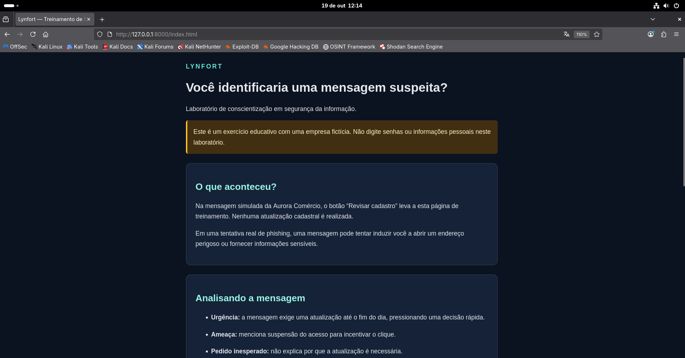
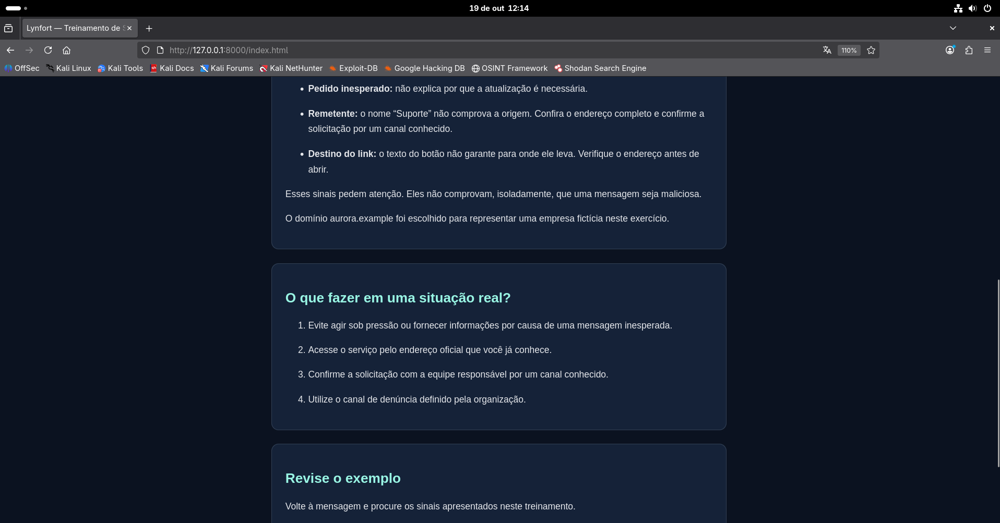
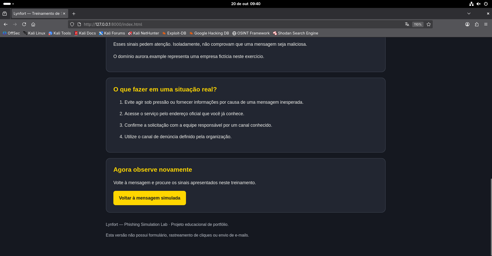

# Lynfort — Phishing Simulation Lab

**Projeto desenvolvido por Victor Godoi como entrega do laboratório da DIO, com implementação própria de um cenário educativo da Lynfort.**

Material produzido com finalidade exclusivamente **educacional e defensiva**.

## Sobre o projeto

Este laboratório apresenta uma mensagem corporativa fictícia e uma página de conscientização sobre phishing. O objetivo é compreender a engenharia social, reconhecer sinais suspeitos e documentar uma implementação funcional em ambiente local.

O projeto reúne desenvolvimento em HTML e CSS, uso do Kali Linux em máquina virtual, versionamento com Git e publicação no GitHub. A página educativa utiliza a identidade da Lynfort e o mascote Lyn.

## O que é phishing?

Phishing é uma forma de engenharia social que usa mensagens ou páginas enganosas para induzir alguém a realizar uma ação prejudicial, como fornecer informações sensíveis, abrir um arquivo malicioso ou autorizar uma operação indevida.

A abordagem pode explorar confiança, urgência, medo ou curiosidade. Mensagens podem chegar por e-mail, SMS e aplicativos, inclusive por contas comprometidas de pessoas conhecidas. Por isso, aparência e familiaridade não substituem a verificação da solicitação.

Veja as orientações do [CERT.br sobre phishing e outros golpes](https://cartilha.cert.br/fasciculos/phishing-golpes/fasciculo-phishing-golpes-alta.pdf).

## Como uma tentativa de phishing pode funcionar

Em termos conceituais:

1. **Abordagem:** uma mensagem apresenta um pretexto para chamar atenção.
2. **Indução:** o conteúdo pressiona uma ação, como abrir um link ou fornecer dados.
3. **Interação:** a pessoa acessa um destino ou atende à solicitação sem confirmar sua origem.
4. **Possível impacto:** podem ocorrer exposição de informações, comprometimento de contas ou outras fraudes.

O laboratório representa apenas a navegação educativa. Não implementa captura de credenciais, envio de mensagens ou comprometimento de contas.

## Cenário desenvolvido

**Empresa fictícia:** Aurora Comércio.

**Mensagem:** aviso de atualização cadastral com prazo até o fim do dia e ameaça de suspensão de acesso.

**Fluxo implementado:**

```text
Mensagem fictícia no navegador
              ↓
Botão “Revisar cadastro”
              ↓
Página educativa da Lynfort
              ↓
Análise dos sinais e orientações
              ↓
Retorno à mensagem para revisão
```

Os principais sinais discutidos são a urgência artificial, a ameaça de suspensão, o pedido inesperado e a necessidade de verificar remetente e destino do link. Nenhum desses sinais, isoladamente, comprova fraude.

O planejamento contempla 10 colaboradores fictícios, de COL-01 a COL-10. Nesta versão, são apenas uma definição do cenário: não existem contas ou registros individuais desses participantes.

## Ambiente e tecnologias

| Recurso | Utilização |
|---|---|
| Kali Linux | Ambiente de desenvolvimento e testes |
| VirtualBox | Execução da máquina virtual |
| HTML e CSS | Mensagem fictícia e página educativa |
| Python 3 | Servidor de arquivos para acesso local |
| Git e GitHub | Histórico e disponibilização do projeto |

O SEToolkit foi explorado na etapa inicial de aprendizagem. A versão apresentada neste repositório funciona com páginas próprias e servidor local, sem depender do SEToolkit ou de integração com GoPhish.

## Como executar

**Pré-requisitos:** Python 3 e navegador. Para obter o projeto pelo terminal, também é necessário Git.

Clone o repositório e entre na pasta:

```bash
git clone https://github.com/BR-Godooy/Lynfort-phishing-simulation-lab.git
cd Lynfort-phishing-simulation-lab
```

Se você já possui os arquivos, abra um terminal na pasta principal do projeto.

Inicie o servidor:

```bash
python3 -m http.server 8000 --bind 127.0.0.1 --directory lab/paginas
```

Abra no navegador da mesma máquina:

**http://127.0.0.1:8000/mensagem.html**

Mantenha o terminal aberto. Para encerrar, pressione **Ctrl + C**. Após reiniciar a máquina, inicie novamente o servidor.

O endereço de loopback limita o atendimento à própria máquina. No ambiente testado, o navegador e o servidor são executados dentro do Kali. Publicar os arquivos no GitHub não inicia esse servidor nem publica automaticamente o site.

## Estrutura principal

```text
Lynfort-phishing-simulation-lab/
├── README.md
├── lab/
│   ├── cenarios/
│   │   └── cenario-01.md
│   └── paginas/
│       ├── index.html
│       ├── mensagem.html
│       └── assets/
│           └── imagens/
│               ├── logo-lynfort.png
│               └── lyn-mascote.png
└── screenshots/
```

## Resultados e validação

A primeira versão demonstrou o fluxo local entre a mensagem simulada e o conteúdo educativo. A identidade visual da Lynfort foi aplicada, e o autor confirmou o funcionamento dos links após a atualização.

| Verificação manual | Resultado relatado |
|---|---|
| Abertura da mensagem fictícia | Funcionou |
| Navegação para a página educativa | Funcionou |
| Exibição do logo e do mascote | Funcionou após atualização do navegador |
| Retorno à mensagem | Funcionou |
| Leitura em janela reduzida, na versão anterior à atualização visual | Sem cortes ou rolagem horizontal |
| Navegação por Tab e ativação com Enter, na versão anterior à atualização visual | Funcionou |

Os testes de janela reduzida e teclado devem ser repetidos após mudanças de layout. Esta validação não equivale a uma auditoria completa de acessibilidade ou compatibilidade entre navegadores.

**Não foram medidas taxas de clique, entrega, denúncia ou aprendizagem.** Não houve campanha de e-mail nem teste com colaboradores reais. O resultado comprovado pelo exercício é o funcionamento da navegação local, conforme os testes manuais relatados pelo autor.

O roteiro está em [Cenário 01](lab/cenarios/cenario-01.md).

## Capturas da página educativa

As imagens abaixo mostram a página em sequência de leitura.

### Parte 1 — Apresentação



### Parte 2 — Continuação do conteúdo



### Parte 3 — Continuação e encerramento



Outras evidências estão na pasta [screenshots](screenshots/).

## Como se defender

- Avalie o contexto da solicitação e confirme pedidos inesperados por um canal conhecido.
- Verifique remetente e endereço de destino; não confie apenas no nome exibido ou no desenho da página.
- Acesse serviços por um endereço oficial conhecido em vez de seguir links recebidos.
- Não compartilhe senhas ou códigos de autenticação.
- Utilize senhas únicas e autenticação multifator. Quando disponível, prefira métodos resistentes a phishing, como FIDO/WebAuthn; nem todo método de MFA oferece a mesma proteção.
- Em organizações, utilize o canal de denúncia e procure a equipe responsável pela segurança.

Referências: [CERT.br — dicas de segurança](https://cartilha.cert.br/dicas-rapidas/) e [CISA — MFA resistente a phishing](https://www.cisa.gov/sites/default/files/2023-01/fact-sheet-implementing-phishing-resistant-mfa-508c.pdf).

## Se você já interagiu com uma mensagem suspeita

Interrompa a interação e comunique a equipe de suporte ou segurança, quando houver. Não volte ao link recebido para tentar corrigir o problema.

Se informou uma senha, utilize o serviço oficial, a partir de um dispositivo confiável, para trocá-la e revisar sessões e métodos de recuperação. Troque também senhas reutilizadas. Se houve abertura de arquivo, instalação de programa ou exposição de dados financeiros, procure o suporte responsável e os canais oficiais das instituições envolvidas.

Para orientações adicionais, consulte os [fascículos do CERT.br](https://cartilha.cert.br/fasciculos/).

## Escopo e limites

- Uso educacional em ambiente próprio ou expressamente autorizado.
- Empresa, remetente e mensagem fictícios.
- Nenhuma solicitação ou armazenamento de senhas.
- Nenhum envio de e-mails ou rastreamento individual.
- Nenhuma clonagem funcional de serviços de terceiros.
- Nenhuma estatística de campanha nesta versão.

## Evolução planejada

- Repetir e documentar os testes após cada mudança visual.
- Organizar os documentos de arquitetura e metodologia.
- Acrescentar exercícios de identificação de sinais suspeitos.
- Explorar indicadores com dados sintéticos claramente identificados.
- Avaliar ferramentas de simulação em ambiente autorizado.

## Recursos e referências

- [CERT.br — Phishing e Outros Golpes](https://cartilha.cert.br/fasciculos/phishing-golpes/fasciculo-phishing-golpes-alta.pdf).
- [CERT.br — Cartilha de Segurança para Internet](https://cartilha.cert.br/).
- [NIST — Phishing](https://www.nist.gov/itl/smallbusinesscyber/guidance-topic/phishing).
- [CISA — Implementing Phishing-Resistant MFA](https://www.cisa.gov/sites/default/files/2023-01/fact-sheet-implementing-phishing-resistant-mfa-508c.pdf).
- [Repositório do desafio usado como referência de estudo — brenoluizdev](https://github.com/brenoluizdev/cibersecurity-desafio-phishing).

A referência do desafio orientou o estudo. O cenário, as páginas e a documentação deste laboratório foram elaborados para o projeto Lynfort, com apoio de ferramentas de IA no desenvolvimento e na redação.

## Autor

**Victor Godoi** — [BR-Godooy no GitHub](https://github.com/BR-Godooy).

Projeto desenvolvido como entrega do laboratório da **DIO**, no contexto de aprendizagem e construção do portfólio da **Lynfort**.

**Material produzido com finalidade exclusivamente educacional e defensiva.**
